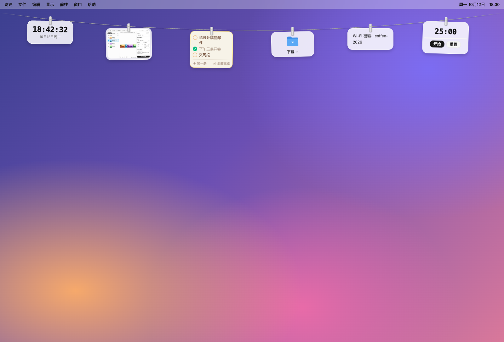
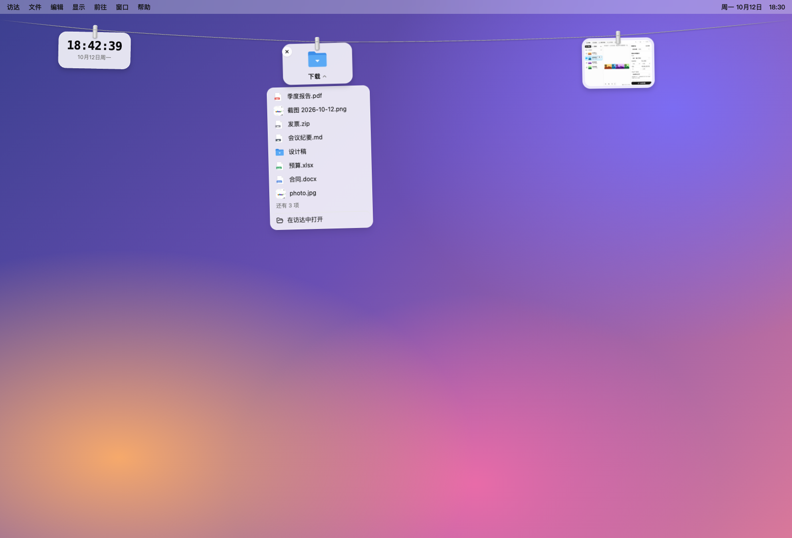
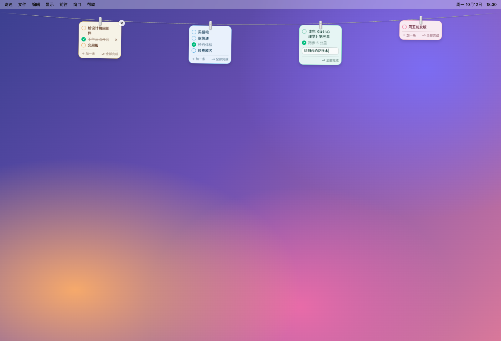
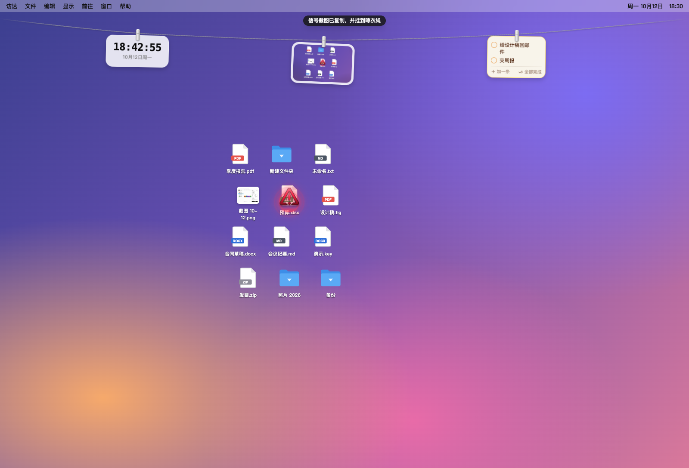
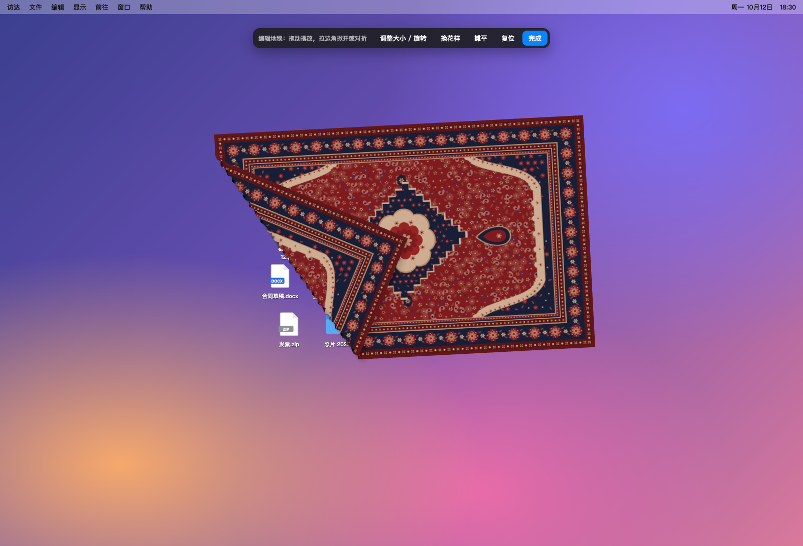
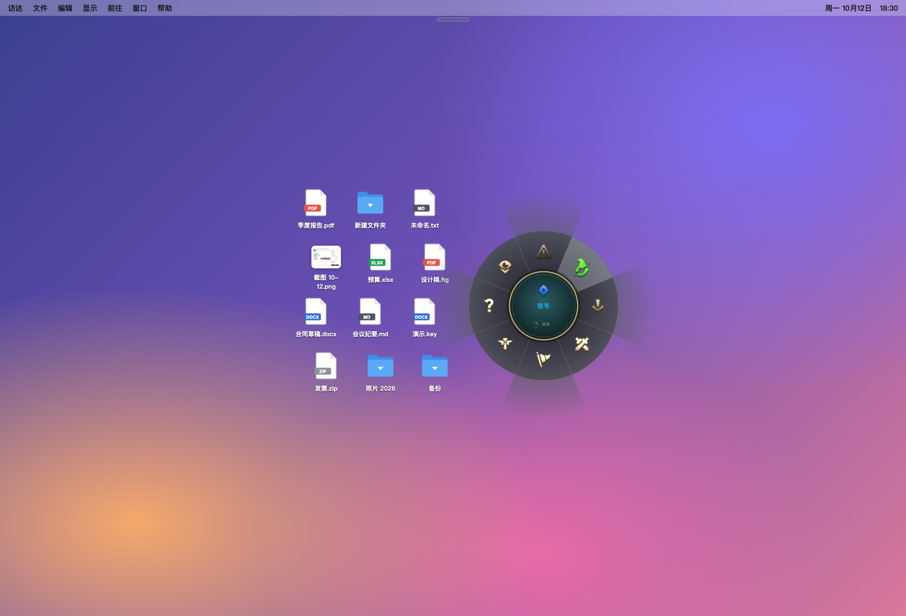
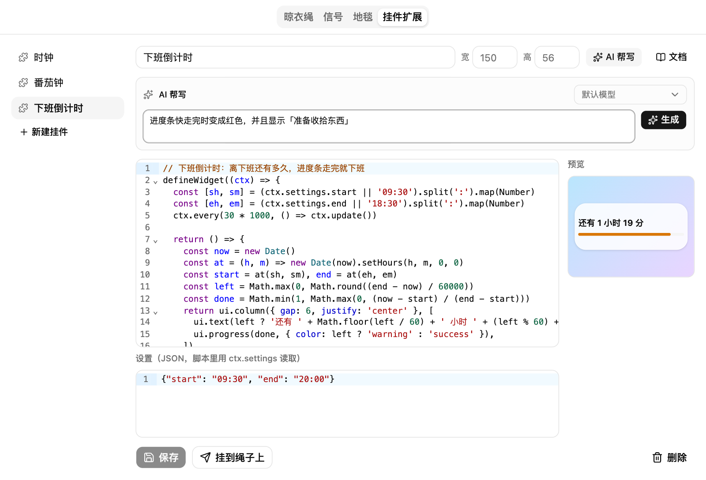

<p align="center"></p>

<h1 align="center">桌面晾衣绳</h1>

<p align="center">uTools 插件：在屏幕顶部拉一根晾衣绳，截图、便签、文件、待办和小挂件都夹在上面；附带游戏风格的屏幕信号和藏桌面图标的地毯。</p>



## 功能

- **晾衣绳**：透明置顶的悬浮层，除了挂着的东西都能点穿；自动隐藏或常驻，选择显示的屏幕，适配刘海屏
- **什么都能挂**：图片、截图、文字便签、文件、文件夹衣架、待办卡、挂件；单击复制、双击打开、拖到其他应用发送
- **待办卡片**：每张最多 6 条，就地添加、标记完成、一键完成，5 种配色，把手上显示未完成数量
- **挂件扩展**：声明式 API（固定入口 + 渲染函数 + 受限元素），在沙箱 Worker 中运行，带看门狗和报错记录；编辑器补全、悬停文档，支持 uTools AI 帮写；内置时钟和番茄钟
- **信号**：全局快捷键在光标处弹出信号轮盘，播放信号动画并截取一块屏幕，复制并挂到晾衣绳；英雄联盟风格和开源图标风格可切换
- **桌面地毯**：铺在桌面图标上、应用窗口下面的 WebGL 布料，随时拖动、掀开、对折，编辑模式调整大小、旋转和花样；可以选铺在哪几块屏幕上
- **多屏**：信号在任何屏幕都能发；可选每块屏幕一根晾衣绳
- **MCP 工具**：通过 uTools MCP 服务向 Claude Code、Codex 等 AI Agent 提供挂东西、读取和取下、待办、发信号等工具

完整的使用说明见 [release/发布文案.md](release/发布文案.md)。

| | |
| --- | --- |
|  |  |
|  |  |
|  |  |

## 技术栈

- 设置界面与悬浮层：React 19 + Vite + Tailwind CSS v4 + shadcn/ui（Radix）
- 扩展编辑器：CodeMirror 6
- 桌面地毯：three.js + Paper Shaders
- 窗口：`utools.createBrowserWindow` 创建的透明窗口，主界面的 `public/preload.js` 统一管理状态

## 开发

```bash
pnpm install
pnpm build        # 输出到 dist/
pnpm watch        # 监听修改并持续构建
```

在 uTools 开发者工具中导入 **`dist/plugin.json`**（不要导入 `public/plugin.json`）。

目录说明：

- `public/preload.js`：主界面 preload，管理晾衣绳状态、悬浮层和地毯窗口、截图与数据存储
- `public/overlay_preload.js` / `public/rug_preload.js`：悬浮层和地毯窗口的桥接层（每块屏幕各一个窗口，消息都带上所在屏幕的 id）
- `public/mcp_tools.js`：MCP 工具，声明在 `public/plugin.json` 的 `tools` 字段，由主界面 preload 注册
- `src/overlay/`：晾衣绳悬浮层（绳子物理、夹子、各类挂件）
- `src/widget/`：挂件扩展的运行时、API 定义（`spec.ts` 同时生成补全、类型、文档和 AI 提示）
- `src/ping/`：信号轮盘与特效
- `src/rug/`：桌面地毯
- `release/`：发布用的 Logo、截图和文案

## 在 uTools 之外运行

可以用 [whatevertools](https://whatevertools.mowtwo.com) 打包成不依赖 uTools 的 Electron 独立应用（[案例说明](https://whatevertools.mowtwo.com/cases/desktop-widgets)）：

```bash
pnpm build
npx whatevertools pack dist --target electron --product 桌面晾衣绳
```

透明置顶的悬浮层、桌面地毯只在桌面上成立，`dist/whatevertools.json` 里声明了 `targets: ["utools", "electron"]`，不出网页版。这个文件只给兼容层用，uTools 不读取。

## 致谢

- 晾衣绳造型参考 [Tendedero](https://github.com/alejandrobujan/tendedero)（MIT）
- 桌面地毯移植自 [desktop-rug](https://github.com/josssphzhou/desktop-rug)（MIT），创意与视觉设计来自 Terkel
- 信号轮盘与特效移植自 [lolPing](https://github.com/darrenprx/lolPing)（MIT）。本插件依据 Riot Games 的「Legal Jibber Jabber」政策使用 Riot Games 拥有的素材制作，Riot Games 不认可也不赞助本项目
- 开源风格信号：图标来自 [game-icons.net](https://game-icons.net)（CC BY 3.0），音效来自 [Kenney](https://kenney.nl)（CC0）

第三方许可证全文见 [NOTICE](NOTICE)。

## License

[MIT](LICENSE)
